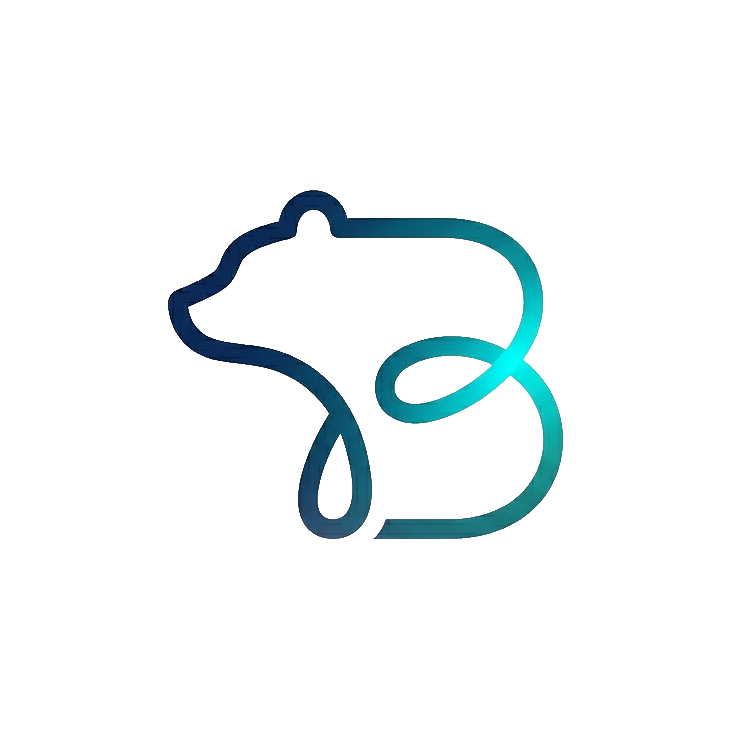

<div align="center">



# Bearvil

**Calm, private software from an independent studio.**

The source of the official Bearvil website: the studio's projects, an about page, contact details and the privacy policies of the published apps. A plain static site on GitHub Pages, with no build step.

[](https://bearvil.github.io)


Light and dark theme · Seven languages · No tracking

</div>

## What's here

- **Home, Projects, About and Contact** pages sharing one navigation, footer, theme and language menu.
- **Standalone privacy policy pages** for each published project.
- **A token-driven design system** with a living style guide at [`/styleguide`](https://bearvil.github.io/styleguide) (internal, `noindex`, not linked from the navigation).
- **Plain HTML, CSS and JavaScript.** No framework, no bundler, no dependencies beyond Google Fonts.

## Features

- **Light and dark theme.** Follows the system setting by default; the navigation toggle stores an explicit choice. The theme is set before the first paint, so there is no flash. See [theming](docs/theming.md).
- **Seven languages.** English, Croatian, German, Spanish, Italian, Chinese and Japanese, picked from the browser languages or the navigation menu and translated client-side with no English flash. Only English is indexed by search engines. See [i18n](docs/i18n.md).
- **Token-driven design.** A "Caribbean / beach" palette (turquoise and pastel orange on warm sand, or on deep night teal in dark) and Inter type. Every colour and scale is a CSS custom property in `assets/css/tokens.css`.
- **Projects page.** All Bearvil software, not only apps: a project index on top, then showcases grouped by type (mobile apps: Frend AI, Touchy Fingies, Dicty; browser extensions: Bookmark-Tab Title), each with type and store-status badges, its icon, "privacy at a glance" facts and a privacy policy link. Home shows the same projects as tiles.
- **Click-to-copy email** that falls back to a regular `mailto:` link when the Clipboard API is unavailable.
- **Social previews.** Open Graph and `summary_large_image` Twitter cards with a shared 1200×630 image on the public pages.
- **Accessibility.** Keyboard-friendly navigation with visible focus styles and ARIA attributes; separate text and fill tokens keep contrast in both themes; `prefers-reduced-motion` stops the wave motion and card lift; content is visible without JavaScript.
- **Performance.** Non-blocking font loading, a tiny synchronous theme script, a CSS-only animated background and explicit image dimensions.
- **Security.** A Content-Security-Policy meta tag (Google Fonts is the only external origin; `script-src 'self'`, no inline scripts), a strict referrer policy and no third-party scripts.

## Pages

| URL | File | Notes |
|---|---|---|
| [`/`](https://bearvil.github.io/) | `index.html` | Home: wave hero, project tiles, principles |
| [`/work`](https://bearvil.github.io/work) | `work.html` | Projects: index and showcases by type |
| [`/about`](https://bearvil.github.io/about) | `about.html` | Studio story, values, FAQ |
| [`/contact`](https://bearvil.github.io/contact) | `contact.html` | Click-to-copy email, privacy policy links |
| `/styleguide` | `styleguide.html` | Internal, `noindex`, not linked from the navigation or footer |
| any missing path | `404.html` | Custom 404 page |

GitHub Pages serves extensionless URLs (`/work` resolves to `work.html`) and uses the root `404.html` for any missing path.

## Privacy policies

Each policy is a standalone page with its own branding, published under `/privacy-policies/`.

| Project | Policy |
|---|---|
| Frend AI | [bearvil.github.io/privacy-policies/frend-ai-pp](https://bearvil.github.io/privacy-policies/frend-ai-pp) |
| Touchy Fingies | [bearvil.github.io/privacy-policies/touchy-fingies-pp](https://bearvil.github.io/privacy-policies/touchy-fingies-pp) |
| Dicty | [bearvil.github.io/privacy-policies/dicty-pp](https://bearvil.github.io/privacy-policies/dicty-pp) |
| Bookmark-Tab Title ([source](https://github.com/bearvil/bookmark-tab-title)) | [bearvil.github.io/privacy-policies/bookmark-tab-title-pp](https://bearvil.github.io/privacy-policies/bookmark-tab-title-pp) |

To add one, follow [docs/guides/adding-a-privacy-policy.md](docs/guides/adding-a-privacy-policy.md): create `privacy-policies/<name>-pp.html` and add it to `PRIVACY_LINKS` in `assets/components.js`, so the navigation dropdown updates on every page.

## Structure

```
.
├── index.html, work.html, about.html, contact.html, 404.html, styleguide.html
├── assets/
│   ├── theme.js           # Sets the light/dark theme before first paint (sync, in <head>)
│   ├── components.js      # Shared Web Components (navigation, backgrounds, footer, behaviours)
│   ├── i18n/              # boot.js, i18n.js and the hr, de, es, it, zh, ja dictionaries
│   ├── apps/              # Project icons, 256×256 PNG
│   ├── css/               # tokens, base, components, ui, patterns and per-page styles
│   ├── og-image.png       # Social preview image, 1200×630
│   ├── favicon.png        # Favicon, 256×256
│   └── Bearvil-logo*.png  # Logo assets
├── privacy-policies/      # One standalone HTML page per project, plus its icon
├── docs/                  # Detailed documentation
└── serve.py               # Dev-only local preview (not part of the deployed site)
```

English is the HTML itself; the dictionaries in `assets/i18n/` translate it client-side.

## Shared components

All main pages (Home, Projects, About, Contact, 404, style guide) share the theme, language, navigation, background, footer and behaviours through `assets/theme.js`, `assets/i18n/` and `assets/components.js`: vanilla [Web Components](https://developer.mozilla.org/en-US/docs/Web/API/Web_components), no build step. Privacy policy pages are intentionally standalone and use none of them.

```html
<script src="/assets/theme.js"></script>                 <!-- sync, before the stylesheets -->
<script src="/assets/i18n/boot.js"></script>             <!-- sync, right after theme.js -->
<link rel="stylesheet" href="/assets/css/tokens.css" />  <!-- then base, components, ui, [patterns], [page] -->
<script src="/assets/components.js" defer></script>
<script src="/assets/i18n/i18n.js" defer></script>       <!-- after components.js -->
```

| Usage | What it does |
|---|---|
| `<top-nav>` | Fixed top bar: logo, inline links, a Privacy Policies dropdown, the language menu, a theme toggle, and a hamburger that opens a fullscreen menu on small screens. Links are defined once in `NAV_LINKS` / `PRIVACY_LINKS` in `components.js`. |
| `<main-background>` | Flat, subtle background wash on every page except Home. |
| `<home-background>` | Animated wave sky behind the Home hero only. Token-coloured, so it follows the theme; frozen on `prefers-reduced-motion`. |
| `<site-footer>` | Slim frosted footer: brand lockup, navigation and privacy links, email, copyright. |
| `<a data-copy-email href="mailto:…">` | Click copies the address and shows feedback; falls back to `mailto:`. |
| `data-font-reveal` | Content fades in once the display font has loaded. Pair with a `<noscript>` fallback. |

All colours and scales are tokens in `tokens.css` (with a dark-theme block); no raw colours live anywhere else. Two page layouts live in `base.css`: `.content` (a centred single hero, used by Contact and 404) and `.page-sections` (stacked sections, used by Home, Projects and About).

## Documentation

This README is the overview. The "how it works / how to do X" documentation lives in [`docs/`](docs/README.md):

- [Architecture](docs/architecture.md): structure, GitHub Pages, page composition, routing, SEO, security.
- [Design system](docs/design-system.md): palette (light and dark), type and other scales, accessibility. Live: [`/styleguide`](https://bearvil.github.io/styleguide).
- [Theming](docs/theming.md): how the light/dark theme works and how to add a theme-aware token.
- [Languages (i18n)](docs/i18n.md): the language selector, translating new text, adding a language.
- [Shared components](docs/components.md): navigation, backgrounds, footer, theme helpers, behaviours.
- [Styling](docs/styling.md): where styles live, the cascade, layouts, utility, primitive and pattern classes.
- Guides: [adding a page](docs/guides/adding-a-page.md) · [adding a privacy policy](docs/guides/adding-a-privacy-policy.md)

## Local preview

No tooling is required. Open `index.html` in a browser, or serve it locally:

```sh
python3 serve.py            # http://localhost:8000 (recommended)
```

`serve.py` mimics GitHub Pages routing: it resolves extensionless URLs to their `.html` file (`/contact` serves `contact.html`) and serves the custom `404.html` for missing paths, so the navigation links and the 404 page behave as in production.

`python3 -m http.server 8000` also works, but extensionless URLs return 404 and the custom 404 page is not served (both are GitHub Pages features).

## Deployment

Push to the default branch and GitHub Pages publishes the site automatically. Everything must keep working as a plain static site, with no server and no build step.

## Contact

bearvil.info@gmail.com
